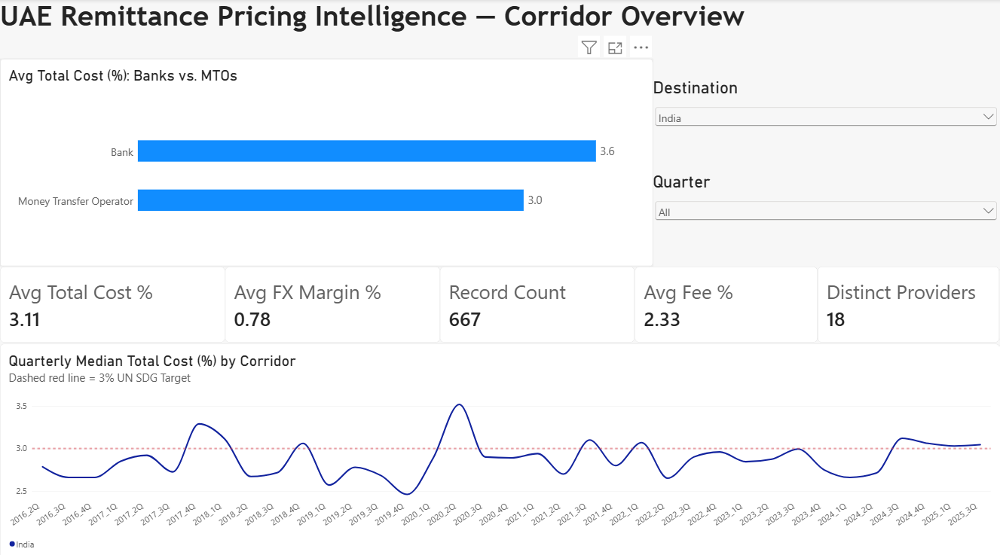
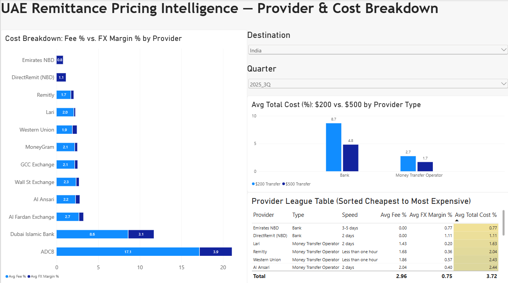
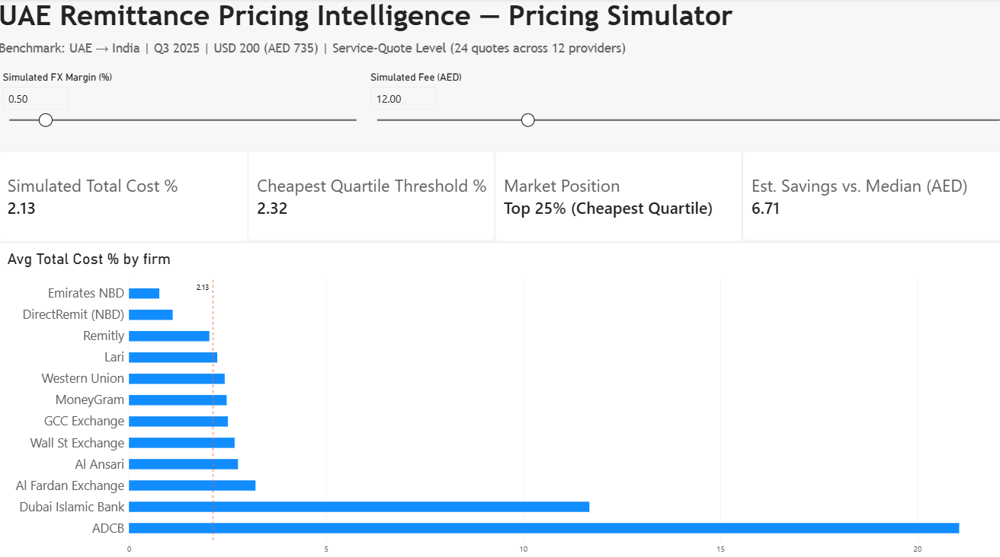

# UAE Remittance Pricing Intelligence (Power BI)

An interactive 3-page Power BI market benchmarking and pricing intelligence dashboard analyzing remittance costs from the UAE across 5 major corridors (India, Pakistan, Bangladesh, Philippines, and Nepal) from Q2 2016 to Q3 2025.

## Dashboard Preview

### 1. Corridor Overview

### 2. Provider & Cost Breakdown

### 3. Interactive Pricing Simulator

---

## Business Problem
Exchange houses, banks, and digital transfer apps in the UAE compete aggressively on the UAE-to-India corridor across fixed fees, FX margins, and transfer speed. This report benchmarks provider pricing against World Bank data and models the exact fee and FX-margin combinations required to rank in the cheapest quartile of the market.

## Key Findings (UAE → India, Q3 2025 — 24 Quotes Across 12 Providers)
* **Benchmark Validation:** Q3 2025 dashboard figures match published World Bank corridor data at **3.72%** mean total cost for USD 200 (AED 735) and **2.19%** for USD 500 (AED 1,835).
* **Outlier Skew & Sampling Bias:** Two high-fee bank offerings (ADCB at **21.06%** and Dubai Islamic Bank at **11.68%**) pull the mean up from **2.56%** to **3.72%**, making the **3.04% median** a far more reliable headline metric. Furthermore, the apparent 2024 cost jump was a sampling artifact from ADCB entering the dataset—the 7 core providers tracked across all 37 quarters remained flat (~2.8%) over 9 years.
* **Fixed Fees Drive ~80% of Cost:** Average fixed fees account for **2.96%** (79.7% of total cost) vs. **0.75%** average FX margin. Zero-fee bank rails (Emirates NBD at **0.77%**, DirectRemit at **1.11%**) monetize purely through FX spread.
* **Cheapest Quartile Threshold:** A provider must price at or below **2.32% total cost** to rank in the cheapest 25% of quotes.

## Data Source & Methodology
* **Source:** World Bank — *Remittance Prices Worldwide* (`rpw_dataset_2011_2025_q3.xlsx`)
* **Scope:** Q2 2016 – Q3 2025 (37 quarters; 2,905 transparent service quotes across 5 UAE corridors; 667 transparent quotes for UAE → India).
* **Data Quality & Limitations:**
  * Standardized `transparent` casing in Power Query and filtered to `transparent = Yes` so undisclosed FX margins (logged as `0%` in raw data) do not distort averages.
  * Restricted historical analysis to Q2 2016 onward due to schema changes in earlier waves; `2025_2Q` is absent from the World Bank source release.
  * Benchmarks reflect unweighted service-quote snapshots rather than transaction-volume-weighted market shares.